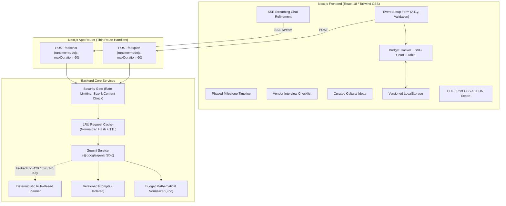

# PlanCraft AI — Production GenAI Event Planning Assistant

[](https://github.com/org/event-planning-assistant/actions/workflows/ci.yml)
[](https://www.w3.org/WAI/WCAG21/AA/)
[](https://www.typescriptlang.org/)
[](LICENSE)

A production-quality, GenAI-powered Event Planning Assistant engineered to help organizers plan **weddings, birthdays, and community events** with strict mathematical budget integrity, chronologically phased timelines, categorized vendor vetting checklists, and culturally authentic personalized ideas.

---

## 1. Architecture Overview



---

## 2. Features Mapped to Problem Statement

| Feature Requirement | Implementation Details |
| :--- | :--- |
| **1. Event Setup Form** | Validated form capturing event type (wedding, birthday, community), target date, city, guest count (1-50,000), total budget (min 1,000 to 100M), currency selector (`INR`, `USD`, `EUR`, `GBP`), themes, and cultural/dietary notes. Accessible with visible labels, `aria-live`, and keyboard support. |
| **2. AI-Generated Plan** | Powered by the official `@google/genai` SDK using native JSON structured output (`responseJsonSchema` aligned with Zod). Features budget breakdowns summing **strictly** to total budget, milestone timelines (T-minus weeks), categorized vendor checklists with vetting questions, and authentic cultural ideas. |
| **3. Interactive Budget Tracker** | Real-time expense tracker where users input actual spend per category and view variances (over/under). Includes an accessible, lightweight **custom SVG chart** paired with a companion WCAG-compliant HTML data table. |
| **4. Chat Refinement** | Live conversational assistant allowing on-the-fly modifications ("cut decor by 15%", "add Mehendi coordination"). Streams text smoothly using Server-Sent Events (SSE) with abort control. |
| **5. Plan Persistence** | LocalStorage persistence with versioned schema (`CURRENT_PLAN_STORAGE_KEY`) and Zod safe parsing to safeguard against corrupted states. |
| **6. Export & Share** | Native print/PDF export formatted with dedicated `@media print` CSS (hiding navs and buttons for a clean 2-page brief), raw JSON export, and single-click checklist clipboard copying. |
| **7. Zero-Key Fallback Mode** | When `GEMINI_API_KEY` is omitted, exhausted, or encounters 429/5xx, seamlessly activates `backend/services/fallbackPlanner.ts` to generate authentic, mathematically balanced plans without breaking. |

---

## 3. Environment Variables

Create a `.env.local` file based on `.env.example`:

| Variable | Required | Default | Description |
| :--- | :---: | :---: | :--- |
| `GEMINI_API_KEY` | **Optional** | `""` | Google Gemini API key from [Google AI Studio](https://aistudio.google.com/). If omitted, the app operates in deterministic fallback mode. |
| `GEMINI_MODEL` | No | `gemini-2.5-flash` | The Gemini model identifier. |
| `LLM_TIMEOUT_MS` | No | `25000` | Network timeout for Gemini API calls in milliseconds. |
| `RATE_LIMIT_PLAN_RPM`| No | `10` | Allowed plan generation requests per minute per IP. |
| `RATE_LIMIT_CHAT_RPM`| No | `20` | Allowed chat refinement requests per minute per IP. |
| `NODE_ENV` | No | `development` | Runtime environment (`development`, `test`, `production`). |

---

## 4. Local Installation & Development

```bash
# 1. Clone repository
git clone <repo-url>
cd event-planning-assistant

# 2. Install dependencies
npm install

# 3. Configure environment variables (optional for AI mode)
cp .env.example .env.local

# 4. Run development server
npm run dev
```

Visit [http://localhost:3000](http://localhost:3000) in your browser.

---

## 5. Testing & Verification

```bash
# Run all unit, integration, and accessibility tests with coverage
npm test

# Run tests in interactive watch mode
npm run test:watch

# Run linter
npm run lint

# Run strict TypeScript typechecking
npm run typecheck

# Run Playwright E2E and Axe audits (requires dev server or built app)
npx playwright test
```

---

## 6. Vercel Deployment

Deployable with zero extra configuration:

1. **Push repository** to GitHub, GitLab, or Bitbucket.
2. In the **Vercel Dashboard**, click **Add New > Project** and select your repository.
3. In **Environment Variables**, add:
   - `GEMINI_API_KEY`: Your Google Gemini API key.
   - `GEMINI_MODEL`: `gemini-2.5-flash` (or omit for default).
4. Click **Deploy**. Vercel will build and serve your Next.js App Router application automatically.

---

## 7. Security & Accessibility Highlights

- **Security Headers**: Strict CSP, HSTS, `X-Frame-Options: DENY`, `X-Content-Type-Options: nosniff` in `next.config.mjs`.
- **Prompt Injection Defense**: User input sanitized, length-capped, and wrapped in `<user_input>` delimiters.
- **Zero Dangerous HTML**: No `dangerouslySetInnerHTML`; all responses rendered as safe React text nodes.
- **WCAG 2.1 AA Compliant**: Semantic landmarks (`<header>`, `<main>`, `<footer>`), skip-to-content link, `aria-live` announcements, touch targets >= 44px, and contrast >= 4.5:1.
